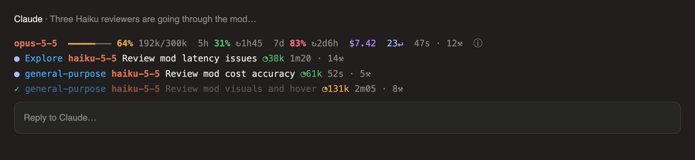
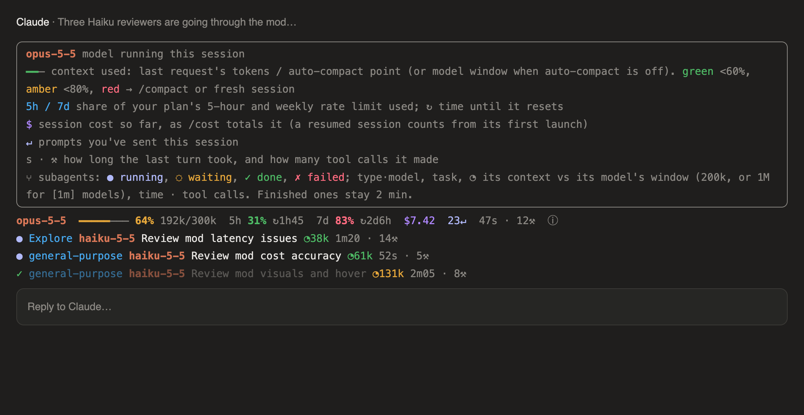

# claude-mods

Mods (hooks-module plugins) for Claude Code.

## context-meter

A coloured band above the prompt: context, rate limits, cost, and live subagents at a glance.



Rest the pointer on **ⓘ** (far right of the first line) for about 0.7 seconds to see what each number means; passing over it does nothing. The legend opens above the band and only takes the rows the band has room for, so ⓘ never moves out from under the pointer. Where there's no pointer (VS Code, mobile) a **?** button toggles it.



<sub>Previews rendered from the mod's layout and theme colours; exact colours follow your Claude Code theme.</sub>

- **Context bar**: tokens on the last request vs your auto-compact point (follows `/autocompact`; the model window when auto-compact is off). Green <60%, amber <80%, red after. Updates live on every model request.
- **5h / 7d**: plan rate-limit usage, ↻ time until reset (kept fresh every 30s).
- **$**: session cost as `/cost` totals it (`<$0.01` for tiny amounts; a resumed session counts from its first launch).
- **↵** prompts sent · **s · ⚒** last turn's duration and tool calls.
- **Subagents**, one aligned row each: ● running, ◌ waiting, ✓ done, ✗ failed; type, model, task (as much as fits), ◔ context vs its model's window (200k, or 1M for `[1m]` models), ≈ estimated cost (its requests' tokens at list price, cache reads and writes included; Claude Code reports cost only per session), time, tool calls. Finished ones stay 2 min.
- Refreshes on model switch, compaction, `/clear`, settings changes and every turn. Narrow windows drop the less important parts.
- Toasts at 60% / 80% context and 80% rate limit.

## Install

At the prompt of a terminal session:

```
/plugin install context-meter --marketplace AieatAssam/claude-mods
```

Answer `y` to add the marketplace, then pick the user scope.

From a shell:

```bash
claude plugin install context-meter --marketplace AieatAssam/claude-mods
```

In the desktop app: click + next to the prompt box → Plugins → Add marketplace `AieatAssam/claude-mods` → Add plugin.

Update later with `claude plugin marketplace update claude-mods`.

## License

[MIT](LICENSE)
