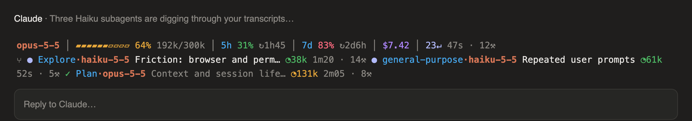
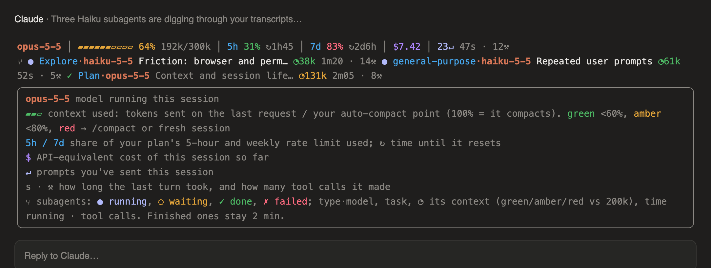

# claude-mods

Mods (hooks-module plugins) for Claude Code.

## context-meter

A coloured band above the prompt: context, rate limits, cost, and live subagents at a glance.



Hover the band for a legend of what each number means:



<sub>Previews rendered from the mod's layout and theme colours; exact colours follow your Claude Code theme.</sub>

- **Context bar**: tokens on the last request vs your auto-compact point (follows `/autocompact`). Green <60%, amber <80%, red after.
- **5h / 7d**: plan rate-limit usage, ↻ time until reset.
- **$**: session cost. **↵**: prompts sent. **s · ⚒**: last turn's duration and tool calls.
- **⑂ subagents**: ● running, ◌ waiting, ✓ done, ✗ failed; type·model, task, ◔ context, time, tool calls. Finished ones stay 2 min.
- Toasts at 60% / 80% context and 80% rate limit. Hover the band for this legend.

## Install

At the prompt of a terminal session:

```
/plugin install context-meter --marketplace AieatAssam/claude-mods
```

Answer `y` to add the marketplace, then pick the user scope.

From a shell:

```bash
claude plugin install context-meter --marketplace AieatAssam/claude-mods
```

In the desktop app: click + next to the prompt box → Plugins → Add marketplace `AieatAssam/claude-mods` → Add plugin.

Update later with `claude plugin marketplace update claude-mods`.

## License

[MIT](LICENSE)
